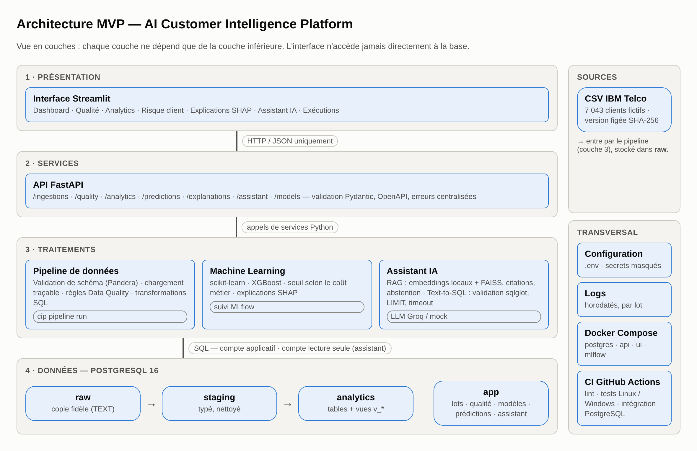

# Architecture



*Figure — Architecture MVP en couches. Démontre la séparation des responsabilités : l'interface ne parle qu'à l'API, les traitements sont regroupés par domaine, et les données sont organisées en couches RAW → STAGING → ANALYTICS, plus une couche APP de traçabilité. Source modifiable : [`diagrams/architecture_mvp.html`](diagrams/architecture_mvp.html).*

> État au 16/11/2026 : la couche 4 (PostgreSQL et ses 4 schémas), la configuration, les logs, la CI et l'acquisition du dataset sont **réalisés**. Les couches 1 à 3 sont **prévues** (sprints 2 à 7).

## 1. Principes

| Principe | Mise en œuvre | Pourquoi |
|---|---|---|
| Couches à dépendance descendante | UI → API → traitements → données | Chaque couche est testable isolément ; une seule couche porte les règles métier. |
| L'interface ne touche jamais la base | Streamlit appelle uniquement l'API | Évite de dupliquer les règles et les contrôles d'accès. |
| Données brutes immuables | `raw` en TEXT, jamais modifié par les transformations | Traçabilité : on peut toujours rejouer depuis la source. |
| Le LLM ne produit pas de chiffres | Chiffres issus du SQL exécuté ; définitions issues de documents cités | Limite les réponses inventées (hallucinations). |
| Moindre privilège | Compte lecture seule limité aux vues `analytics.v_*` pour l'assistant | Même si le LLM génère une requête malveillante, la base la refuse. |
| Configuration externalisée | Variables d'environnement et `.env` non versionné (`cip.config`) | Aucun secret dans Git ; changement d'environnement sans modifier le code. |
| Reproductibilité | `uv.lock`, dataset figé par SHA-256, migrations versionnées | Mêmes entrées → mêmes résultats. |

## 2. Composants

| Composant | Rôle | Technologie | Statut |
|---|---|---|---|
| Acquisition | Télécharger et vérifier la source | Python (urllib, hashlib), Typer | ✅ DE-001 |
| Configuration et logs | Paramètres validés, logs par lot, masquage des secrets | pydantic-settings, logging | ✅ DO-003 |
| Base de données | 4 schémas, migrations versionnées | PostgreSQL 16.16, SQLAlchemy 2, psycopg 3 | ✅ DB-001 |
| Profilage | Faits calculés sur la source | pandas, matplotlib | ✅ RS-001 |
| Ingestion et validation | Chargement RAW traçable | Pandera, SQL | ⏳ S2 |
| Data Quality | Règles mesurables historisées | SQL | ⏳ S3 |
| Transformations | STAGING, ANALYTICS | SQL versionné | ⏳ S2–S3 |
| ML et XAI | Entraînement, seuil, explications | scikit-learn, XGBoost, SHAP, MLflow | ⏳ S4–S5 |
| Assistant IA | RAG et Text-to-SQL | sentence-transformers, FAISS, sqlglot, Groq | ⏳ S6 |
| API | Exposition des services | FastAPI, Pydantic | ⏳ S2 → S6 |
| Interface | Démonstration | Streamlit | ⏳ S7 |
| Conteneurs | Démarrage reproductible | Docker Compose | 🟡 PostgreSQL seul |
| CI | Lint et tests à chaque PR | GitHub Actions (Linux, Windows, PostgreSQL) | ✅ DO-002 / DB-001 |

## 3. Organisation du code

```
src/cip/
  config.py      configuration centralisée            (DO-003)
  log.py         journalisation structurée            (DO-003)
  cli.py         commande `cip`                       (DE-001+)
  data/          acquisition, profilage, figures      (DE-001, RS-001)
  db/            moteur SQLAlchemy, migrations        (DB-001)
database/migrations/   SQL versionné (NNNN_nom.sql)
tests/unit/            sans service externe
tests/integration/     contre un PostgreSQL réel (marqueur `integration`)
```

## 4. Commandes disponibles (réalisées)

| Commande | Effet |
|---|---|
| `cip --version` | Version |
| `cip data download [--force]` | Télécharge et vérifie le dataset |
| `cip data verify` | Contrôle l'empreinte du fichier local |
| `cip data profile` | Profilage + figures dans `report_assets/eda/` |
| `cip db migrate` | Applique les migrations en attente |
| `cip db status` | État de chaque migration |

Décisions détaillées : [`architecture_decisions.md`](architecture_decisions.md).
