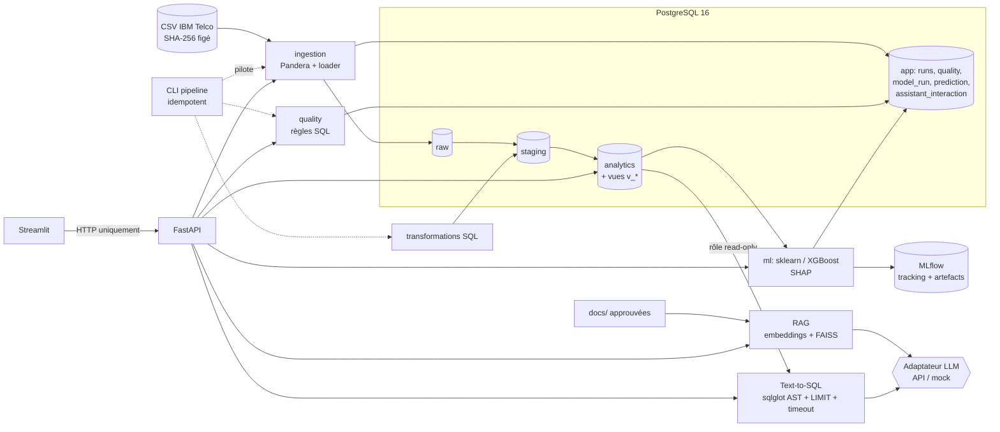

> **Document historique** — version présentée le 16/11/2026 *avant* validation. Les décisions validées et leur statut à jour sont dans [`../architecture_decisions.md`](../architecture_decisions.md) ; l'avancement réel dans [`../weekly_progress.md`](../weekly_progress.md).

# Phase 0 — Cadrage : AI-Powered Customer Intelligence Platform

> Statut : **proposition, à valider** (par l'étudiante, puis l'encadrant).
> Date : 16/11/2026. Base : *Cahier des charges technique v1.0* + vérification réelle du dataset.
> Ce document deviendra `docs/project_charter.md`, `docs/requirements.md` et `docs/architecture.md` une fois validé.

---

## 1. Vérification du dataset (faits observés, pas supposés)

| Élément | Constat vérifié le 16/11/2026 |
|---|---|
| Source téléchargée | `https://raw.githubusercontent.com/IBM/telco-customer-churn-on-icp4d/master/data/Telco-Customer-Churn.csv` (dépôt GitHub officiel de l'organisation IBM) |
| Empreinte SHA-256 | `16320c9c1ec72448db59aa0a26a0b95401046bef5d02fd3aeb906448e3055e91` |
| Volume | **7 043 lignes, 21 colonnes**, 1 ligne d'en-tête |
| Clé | `customerID` : **0 doublon** |
| Cible `Churn` | `No` = 5 174, `Yes` = 1 869 → **taux de churn 26,5 %** (déséquilibre modéré) |
| `TotalCharges` | Stocké en texte ; **11 valeurs vides**, toutes avec `tenure = 0` (clients nouveaux, pas encore facturés) |
| `SeniorCitizen` | Codé `0/1` alors que les autres booléens sont `Yes/No` → incohérence de format à normaliser |
| `tenure` | 0 à 72 mois |
| `MonthlyCharges` | 18,25 à 118,75 (devise non documentée par la source → à signaler comme limite) |
| Modalités dépendantes | `No phone service` (682) et `No internet service` (1 526) : valeurs structurelles, pas des manquants |
| Dimension temporelle | **Aucune**. Le dataset est un *snapshot statique* fictif |

**Licence / provenance.** Le dépôt IBM qui héberge le fichier est publié sous **Apache License 2.0** (fichier `LICENSE` lu). Le dataset est un jeu d'exemple *fictif* créé par IBM (aucune donnée personnelle réelle). Point de vigilance honnête : la licence Apache couvre le dépôt ; IBM ne publie pas de licence séparée explicitement dédiée aux données. Pour un usage académique non commercial, c'est acceptable, à condition de **citer la source et l'empreinte**, et de **faire valider par l'encadrant** (décision D1).

**Conséquences sur le cahier des charges :**
- « Tendances » (FR-06) et « fraîcheur » (Data Quality) : sans date dans les données, on ne peut pas faire de tendance temporelle réelle. On mesurera la fraîcheur **du lot d'ingestion** (`loaded_at`) et on supprimera les « tendances » temporelles du MVP (ou on les fera porter sur l'ancienneté `tenure`, ce qui est honnête).
- `analytics.customer_snapshot` : `snapshot_date` = date d'ingestion du lot. Le modèle reste capable d'accueillir plusieurs snapshots plus tard.
- Unité d'observation ML (§8.1 du CDC) : **un client du snapshot statique**. À écrire noir sur blanc dans `machine_learning.md`.

---

## 2. Audit de faisabilité sur 8 semaines

Hypothèse : ~40 jours ouvrés, une seule personne, dont **~20 % réservés** à la documentation continue, aux imprévus et au rapport. Il reste donc **~32 jours de réalisation**.

| Bloc | Charge estimée (j) | Faisabilité | Verdict |
|---|---|---|---|
| Socle (repo, Docker, Postgres, config, CI minimale) | 3 | Élevée | **MVP** |
| Ingestion CSV → RAW + traçabilité des lots | 3 | Élevée | **MVP** |
| STAGING + ANALYTICS en SQL versionné | 3 | Élevée | **MVP** |
| Data Quality (règles Q-01 à Q-07 + historisation) | 2,5 | Élevée | **MVP** |
| Orchestration par CLI Python (`pipeline run`) | 0,5 | Élevée | **MVP** |
| EDA + baseline + comparaison 3 modèles + seuil | 4 | Élevée | **MVP** |
| SHAP global/local | 1,5 | Élevée | **MVP** |
| MLflow (tracking local) | 1 | Élevée | **MVP** (coût faible, valeur réelle) |
| RAG documentaire (FAISS, citations, abstention) | 3 | Moyenne | **MVP** |
| Text-to-SQL sécurisé | 3,5 | Moyenne (dépend du LLM) | **MVP** avec repli |
| FastAPI (6 modules) + tests | 3 | Élevée | **MVP** |
| Streamlit (6–8 pages) | 3 | Élevée | **MVP** |
| Docker Compose complet + E2E | 1,5 | Élevée | **MVP** |
| **Total MVP** | **≈ 33,5 j** | | **Tendu mais réaliste** |
| dbt Core | +2 à 3 | Moyenne | Complémentaire (décision D4) |
| Airflow | +3 à 4 | Faible (RAM, Windows, temps) | **Optionnel, abandonné par défaut** |
| Great Expectations | +2 | Moyenne | **Remplacé** par Pandera + règles SQL |
| Upload CSV depuis l'UI | +1 | Élevée | Complémentaire |
| Authentification API (clé admin) | +0,5 | Élevée | Complémentaire |
| Détection de dérive | +2 | Moyenne | Optionnel (perspectives) |
| Redis / worker asynchrone | +2 | — | **Abandonné** (aucun besoin réel à ce volume) |
| Déploiement cloud public | +2 | Dépend des accès | Optionnel |

**Conclusion de l'audit :** le cahier des charges est faisable **si et seulement si** Airflow, dbt, Great Expectations, Redis et le worker sortent du chemin critique. Le volume (7 043 lignes) ne justifie aucun outil distribué ni asynchrone. Le risque principal n'est pas technique : c'est la **dispersion** en semaine 6 (deux capacités GenAI) et l'**intégration** en semaine 7.

### Ce qui est trop ambitieux tel qu'écrit dans le CDC
1. **Airflow** : 4 services Docker supplémentaires (webserver, scheduler, init, souvent Redis), 4 Go de RAM recommandés, mal supporté sous Windows hors Docker. Pour un pipeline de 5 étapes lancé à la demande, la valeur ne justifie pas le coût. → Orchestrateur CLI idempotent ; Airflow devient une perspective, avec le DAG décrit dans le rapport.
2. **Great Expectations** : API lourde et changeante. → **Pandera** (validation de schéma côté Python) + **règles SQL** maison historisées dans `app.data_quality_result`. Plus simple à expliquer au jury, et on mesure exactement les mêmes dimensions (complétude, unicité, validité, cohérence, fraîcheur).
3. **Tendances temporelles** : impossibles avec ce dataset (voir §1).
4. **Mode « auto » de l'assistant** (routage SQL vs RAG par le LLM) : à garder simple, avec un routeur par classification LLM, un repli sur le choix explicite de l'utilisateur, et un test sur un jeu de questions.

---

## 3. Périmètre

### 3.1 MVP — indispensable (chemin critique, définit la réussite)
- Ingestion CSV reproductible (CLI + endpoint), validation du schéma, `ingestion_run`, logs, quarantaine.
- PostgreSQL : schémas `raw`, `staging`, `analytics`, `app` ; migrations SQL versionnées.
- Data Quality : règles Q-01…Q-07 + fraîcheur du lot, résultats historisés, rapport.
- Pipeline orchestré : `python -m cip.pipeline run` (ingest → quality → transform → features).
- ML : EDA, baseline LogReg, Random Forest, XGBoost, CV stratifiée, choix du seuil selon le coût FP/FN, test final unique, artefact versionné, MLflow.
- XAI : SHAP global + local, stocké avec la version du modèle.
- GenAI : RAG (FAISS + citations + abstention) **et** Text-to-SQL (rôle read-only, vues autorisées, validation AST, LIMIT, timeout, journalisation).
- FastAPI : health, ingestions, quality, analytics, predictions, explanations, assistant, models.
- Streamlit : Accueil, Qualité, Analytics, Risque client, Model Insights/SHAP, Assistant, Exécutions.
- Docker Compose (postgres, api, frontend, mlflow), Pytest, GitHub Actions (ruff + tests + build).
- Documentation `docs/` continue + `report_assets/`.

### 3.2 Complémentaire (si le planning est tenu à la fin de S5)
- Upload CSV depuis Streamlit.
- Clé API sur les endpoints d'administration (`/ingestions`, entraînement).
- Historique des interactions de l'assistant dans l'UI.
- dbt Core pour la couche analytics (si D4 = oui).
- Jeu d'évaluation GenAI élargi (30+ questions) avec score.

### 3.3 Optionnel — abandonné dès qu'il menace le délai
- Airflow, Great Expectations, Redis/worker, détection de dérive, déploiement cloud, authentification utilisateurs, LLM local lourd.

---

## 4. Architecture

### 4.1 Architecture MVP (celle qu'on livre)

**Principes structurants :**
- **Le frontend ne parle qu'à l'API** (jamais directement à la base) → une seule couche de règles, testable.
- **Le LLM ne produit jamais un chiffre** : les chiffres viennent du SQL exécuté, le LLM reformule. Les définitions viennent des documents récupérés et cités.
- **Deux comptes PostgreSQL au minimum** : `cip_app` (lecture/écriture applicative) et `cip_assistant` (lecture seule, uniquement `analytics.v_*`, `default_transaction_read_only=on`, `statement_timeout`).
- **Idempotence** : un fichier déjà ingéré (même SHA-256) n'est pas rechargé, sauf avec `--force` ; staging/analytics sont reconstruits de façon déterministe à partir du lot choisi.
- **Adaptateur LLM** (interface `LLMClient`) avec une implémentation réelle et une implémentation `mock` déterministe pour les tests et la CI : la CI ne dépend jamais d'une clé.

### 4.2 Architecture cible (perspectives, non livrée)
MVP + Airflow (DAG équivalent au CLI), dbt (lineage, tests déclaratifs), détection de dérive (Evidently ou PSI maison), authentification, déploiement cloud, ingestion multi-sources. Ces éléments vont dans `limitations_and_future_work.md`, pas dans les livrables.

### 4.3 Stack proposée et justification

| Besoin | Choix | Pourquoi (et pourquoi pas l'alternative) |
|---|---|---|
| Langage | Python 3.12 | Compatibilité vérifiée des roues SHAP/XGBoost/FAISS ; 3.13 encore risquée pour certaines libs |
| Dépendances | **uv** + `pyproject.toml` + `uv.lock` | Verrouillage reproductible (NFR-02), rapide, fonctionne sous Windows |
| Base | PostgreSQL 16 (Docker) | Rôles/permissions fins indispensables pour le Text-to-SQL sûr |
| Accès DB | SQLAlchemy 2 + psycopg 3 | Standard, paramétrage des requêtes, pool |
| Migrations | Fichiers SQL numérotés + petit runner | Lisible par le jury ; Alembic serait surdimensionné pour ~10 tables |
| Validation schéma | **Pandera** | Validation de DataFrame déclarative, légère |
| Transformations | SQL versionné (`transformations/sql/`) | Transparent ; dbt en option (D4) |
| Orchestration | CLI Typer idempotent | Couvre 100 % du besoin réel ; Airflow en perspective |
| ML | scikit-learn, XGBoost | Pipeline sklearn = prévention de fuite par construction |
| XAI | SHAP (`TreeExplainer` / `LinearExplainer`) | Standard, explications locales et globales |
| Tracking | MLflow (serveur local, backend Postgres ou fichier) | Comparaison d'expériences tracée = preuve pour le rapport |
| Embeddings | `sentence-transformers` multilingue local (ex. `paraphrase-multilingual-MiniLM-L12-v2`) | Gratuit, hors-ligne, gère le français ; pas de clé nécessaire |
| Index | FAISS (`faiss-cpu`) | Volume de corpus minuscule, aucune base vectorielle à opérer |
| LLM | Adaptateur : API Claude **ou** autre fournisseur selon D5, + mock | Voir décision D5 |
| Garde-fou SQL | **sqlglot** (parsing AST) | Exigence du CDC : « parser, pas vérification textuelle » |
| API | FastAPI + Pydantic v2 | OpenAPI automatique, validation |
| UI | Streamlit | Rapide, adapté à la démo |
| Qualité code | Ruff (lint + format), mypy léger optionnel | Un seul outil rapide |
| Tests | Pytest + pytest-cov ; Postgres de test via service CI | Tests d'intégration réels, pas de base simulée |
| CI | GitHub Actions | Ruff → tests unitaires → tests intégration (service postgres) → build Docker |

---

## 5. Modèle de données — ajustements proposés au CDC

1. `raw.telco_customer` : toutes les colonnes source en `TEXT` + `ingestion_id`, `source_row_number`, `loaded_at`. *Pourquoi pas `payload_json` comme dans le CDC ?* Le TEXT colonne-par-colonne garde la fidélité à la source (aucune conversion) tout en restant interrogeable en SQL simple ; le JSONB compliquerait chaque requête de staging. (Décision D6.)
2. `staging.customer` : noms en `snake_case`, booléens réels, `total_charges NUMERIC` (NULL quand `tenure = 0`, conversion tracée), `senior_citizen BOOLEAN`.
3. `analytics.customer_snapshot` + `analytics.customer_features` ; vues `analytics.v_churn_overview`, `v_churn_by_segment`, `v_customer_risk` (seules vues exposées au Text-to-SQL).
4. `app.*` : conforme au CDC (`ingestion_run`, `data_quality_result`, `model_run`, `prediction`, `assistant_interaction`) + `app.quarantine_row`.
5. Pseudonymisation : `customerID` est déjà un identifiant fictif ; aucune donnée identifiante. On le documente.

---

## 6. Points ML à trancher dès maintenant (pour éviter les pièges)

- **Split** : train 60 / validation 20 / test 20, stratifié, `random_state` fixé, figé dans un fichier d'indices versionné. Le test n'est touché qu'**une fois**.
- **Fuite** : `TotalCharges ≈ tenure × MonthlyCharges` n'est pas une fuite (connu au moment de la prédiction) mais crée de la colinéarité → à discuter en EDA. La cible n'entre dans aucune feature.
- **Seuil** : choisi sur la validation selon une hypothèse de coût FN/FP explicite (ex. perdre un client coûte ~5× une offre de rétention inutile). Hypothèse à valider (D8), présentée comme hypothèse.
- **Variables sensibles** : `gender`, `SeniorCitizen` → test avec/sans, analyse d'écart de performance par groupe, décision documentée.

---

## 7. Registre des risques

| # | Risque | Prob. | Impact | Mitigation | Déclencheur de repli |
|---|---|---|---|---|---|
| R1 | Pas d'accès LLM (clé, coût, quota, politique entreprise) | Moyenne | Élevé | Adaptateur + mock dès S1 ; demander la clé en S1 | Pas de clé fin S5 → assistant en mode « intents SQL prédéfinis + RAG extractif sans génération » |
| R2 | Docker Desktop lent / RAM < 8 Go sous Windows | Moyenne | Élevé | Vérification S1 ; services légers ; pas d'Airflow | Exécution locale hors Docker pour le dev, Docker uniquement pour la démo |
| R3 | Dérive du périmètre (envie d'ajouter Airflow/dbt) | Élevée | Élevé | Règle : aucun ajout avant M5 | — |
| R4 | Text-to-SQL produit du SQL faux mais valide | Élevée | Moyen | Schéma décrit dans le prompt, vues simples, jeu de 20 questions de référence, affichage du SQL à l'utilisateur | Taux < 70 % → restreindre aux intents validés |
| R5 | Injection de prompt via question ou documents | Moyenne | Élevé | Défense en profondeur : AST + rôle read-only + vues ; le garde-fou ne dépend pas du LLM | — |
| R6 | Intégration S7 sous-estimée | Élevée | Élevé | API construite progressivement dès S2 (endpoints par module), pas en big-bang | — |
| R7 | Documentation repoussée en fin de stage | Élevée | Élevé | Carte DOC obligatoire dans chaque sprint ; DoD inclut la doc | — |
| R8 | Jours fériés / indisponibilités (ex. 18/11 Fête de l'Indépendance, 01/01) | Certaine | Faible | Capacité de sprint ajustée | — |
| R9 | Licence du dataset contestée | Faible | Moyen | Citation + empreinte + validation encadrant | Basculer sur données synthétiques générées |

---

## 8. Organisation : comment on va travailler concrètement

**Constat d'accès vérifié aujourd'hui :**
- **Trello** : accès en lecture/écriture disponible via le connecteur (compte `ouardifatimazohra`, fuseau Africa/Casablanca). **Rien n'a encore été créé** : j'attends la validation du backlog.
- **GitHub** : le jeton GitHub de cette session est **invalide** (`gh auth status` en échec). Je ne peux ni créer le dépôt ni pousser pour l'instant. Il faut soit reconnecter GitHub à Claude, soit que tu crées le dépôt vide et me l'attaches.
- **Environnement d'exécution** : je travaille dans un conteneur Linux cloud (Python 3.13 et Docker disponibles). J'y écris le code, j'exécute les tests et je pousse sur GitHub ; toi, tu fais `git pull` et tu exécutes sur ton Windows (commandes PowerShell fournies) pour vérifier sur ta machine. Les deux exécutions servent de preuve.

**Branches** (adaptées à un projet individuel, conformes à ta demande) :
- `main` : uniquement des versions démontrables, taguées `v0.1.0` (fin S1) … `v1.0.0` (fin S8). Merge `develop → main` **uniquement avec ta validation** en fin de sprint.
- `develop` : intégration.
- `feature/<ID>-<slug>` (ex. `feature/DE-003-raw-ingestion`), `fix/<ID>-<slug>`, `docs/<slug>`.
- 1 carte Trello ↔ 1 branche ↔ 1 PR vers `develop` ; la CI doit passer avant le merge.

**Commits** : Conventional Commits, `type(scope): sujet à l'impératif`, scopes : `data, db, quality, ml, xai, genai, api, ui, infra, ci, docs`. Le corps du commit référence la carte (`Refs: DE-003`).

**Definition of Done** (toute carte) : code sur `develop` via PR, CI verte, tests ajoutés, doc mise à jour, preuve rangée dans `report_assets/`, carte Trello mise à jour avec le lien du commit/PR.

---

## 9. Décisions à valider (voir aussi la réponse dans le chat)

| ID | Décision | Ma recommandation |
|---|---|---|
| D1 | Dataset IBM Telco, version et SHA-256 ci-dessus, figés | Oui, + validation encadrant sur la licence |
| D2 | Périmètre MVP / complémentaire / optionnel du §3 | Oui |
| D3 | Airflow hors MVP, orchestrateur CLI | Oui |
| D4 | dbt : SQL pur (MVP) ou dbt dès S3 | SQL pur ; dbt seulement si S3 est en avance |
| D5 | Fournisseur LLM | À confirmer selon l'accès dont tu disposes |
| D6 | RAW en colonnes TEXT plutôt que `payload_json` | Oui |
| D7 | Python 3.12 + uv | Oui |
| D8 | Hypothèse de coût FN/FP pour le seuil | 5:1 provisoire, revue en S5 |
| D9 | Mode de travail : je code/teste/pousse ; tu vérifies sous Windows | Oui |
| D10 | Date de début réelle de S1 et jours non travaillés | À me donner |
