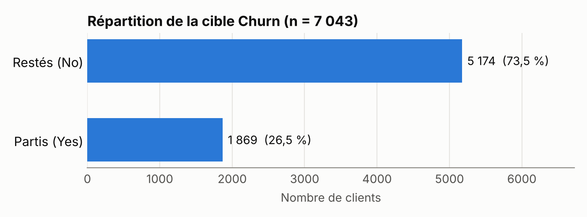
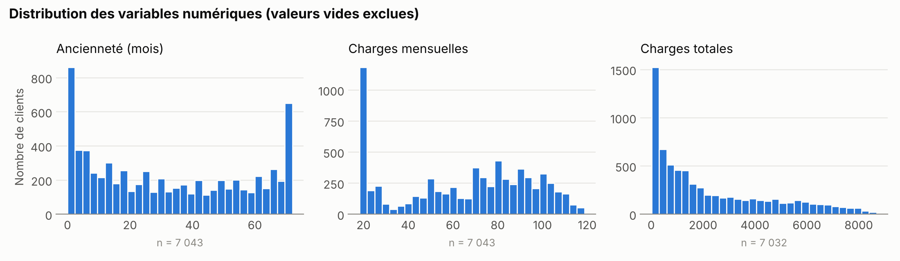

# Dictionnaire de données

> Source : IBM Telco Customer Churn, version figée SHA-256 `16320c9c…3055e91` (voir `data/README.md`).
> **Tous les chiffres de ce document sont calculés** par `uv run cip data profile`
> (résultat brut : [`report_assets/eda/profiling_summary.json`](../report_assets/eda/profiling_summary.json)).
> Profilage réalisé le 16/11/2026 sur le fichier lu **en texte brut**, sans aucune conversion.

## 1. Vue d'ensemble

| Indicateur | Valeur | Remarque |
|---|---|---|
| Lignes | 7 043 | une ligne = un client |
| Colonnes | 21 | 1 identifiant, 16 catégorielles, 3 numériques, 1 cible |
| Lignes entièrement dupliquées | 0 | |
| `customerID` dupliqués | 0 | clé candidate valide |
| Cible `Churn` | No = 5 174 · Yes = 1 869 | **taux de churn 26,54 %** → déséquilibre modéré |
| Valeurs manquantes | 11 (uniquement `TotalCharges`) | voir §3 |

**Unité d'observation** : un client, à un instant unique (snapshot statique, aucune date dans les données).
**Grain cible de `staging.customer`** : une ligne par `customer_id`.

*Figure — Répartition de la cible Churn. Démontre le déséquilibre des classes (26,5 % de départs) : l'accuracy seule serait trompeuse (un modèle qui prédit toujours « No » obtiendrait 73,5 %).*

*Figure — Distribution des variables numériques. Démontre : pic de clients très récents et de clients fidèles (72 mois) pour l'ancienneté ; une population à bas forfait (~20) distincte ; une distribution très asymétrique des charges totales.*

## 2. Dictionnaire colonne par colonne

Type source : toujours `TEXT` dans `raw` (fidélité). Type cible : celui de `staging.customer` (carte DE-004).

| # | Colonne source | Colonne staging | Type cible | Valeurs observées (effectifs) | Règle de transformation / contrôle |
|---|---|---|---|---|---|
| 1 | `customerID` | `customer_id` | `TEXT` (PK) | 7 043 valeurs distinctes, format `NNNN-XXXXX` | Non nul, unique (Q-01, Q-02). Identifiant fictif. |
| 2 | `gender` | `gender` | `TEXT` | Female 3 488 · Male 3 555 | Domaine {Female, Male}. **Variable sensible** : usage dans le modèle à justifier (ML-009). |
| 3 | `SeniorCitizen` | `senior_citizen` | `BOOLEAN` | `0` 5 901 · `1` 1 142 | Codé 0/1 contrairement aux autres booléens (Yes/No) → convertir en booléen. **Variable sensible** (âge). |
| 4 | `Partner` | `has_partner` | `BOOLEAN` | No 3 641 · Yes 3 402 | Yes/No → booléen. |
| 5 | `Dependents` | `has_dependents` | `BOOLEAN` | No 4 933 · Yes 2 110 | Yes/No → booléen. |
| 6 | `tenure` | `tenure_months` | `INTEGER` | min 0 · médiane 29 · moyenne 32,37 · max 72 | ≥ 0 (Q-03). 11 clients à 0 mois. |
| 7 | `PhoneService` | `phone_service` | `BOOLEAN` | No 682 · Yes 6 361 | Yes/No → booléen. |
| 8 | `MultipleLines` | `multiple_lines` | `TEXT` | No 3 390 · Yes 2 971 · No phone service 682 | Valeur structurelle (§3.2). Cohérence : « No phone service » ⇔ `phone_service = false`. |
| 9 | `InternetService` | `internet_service` | `TEXT` | DSL 2 421 · Fiber optic 3 096 · No 1 526 | Domaine fermé (Q-06). |
| 10 | `OnlineSecurity` | `online_security` | `TEXT` | No 3 498 · Yes 2 019 · No internet service 1 526 | Valeur structurelle. Cohérence avec `internet_service = 'No'`. |
| 11 | `OnlineBackup` | `online_backup` | `TEXT` | No 3 088 · Yes 2 429 · No internet service 1 526 | Idem. |
| 12 | `DeviceProtection` | `device_protection` | `TEXT` | No 3 095 · Yes 2 422 · No internet service 1 526 | Idem. |
| 13 | `TechSupport` | `tech_support` | `TEXT` | No 3 473 · Yes 2 044 · No internet service 1 526 | Idem. |
| 14 | `StreamingTV` | `streaming_tv` | `TEXT` | No 2 810 · Yes 2 707 · No internet service 1 526 | Idem. |
| 15 | `StreamingMovies` | `streaming_movies` | `TEXT` | No 2 785 · Yes 2 732 · No internet service 1 526 | Idem. |
| 16 | `Contract` | `contract_type` | `TEXT` | Month-to-month 3 875 · One year 1 473 · Two year 1 695 | Domaine fermé (Q-06). |
| 17 | `PaperlessBilling` | `paperless_billing` | `BOOLEAN` | No 2 872 · Yes 4 171 | Yes/No → booléen. |
| 18 | `PaymentMethod` | `payment_method` | `TEXT` | Electronic check 2 365 · Mailed check 1 612 · Bank transfer (automatic) 1 544 · Credit card (automatic) 1 522 | Domaine fermé (Q-06). |
| 19 | `MonthlyCharges` | `monthly_charges` | `NUMERIC(8,2)` | min 18,25 · médiane 70,35 · moyenne 64,76 · max 118,75 | ≥ 0 (Q-04). Devise non documentée par la source. |
| 20 | `TotalCharges` | `total_charges` | `NUMERIC(10,2)` | min 18,80 · médiane 1 397,48 · moyenne 2 283,30 · max 8 684,80 · **11 valeurs `" "`** | Texte → numérique ; `" "` → `NULL` tracé (Q-07, §3.1). |
| 21 | `Churn` | `churn_label` | `SMALLINT` | No 5 174 · Yes 1 869 | No → 0, Yes → 1 (Q-05). **Cible** : jamais utilisée comme feature. |

Les correspondances ligne à ligne citées en §3 sont recalculées à chaque profilage (champ `consistency` du résumé JSON : 4 règles, toutes `true` sur la version figée).

Aucune colonne ne contient d'espaces parasites en début/fin de valeur, à l'exception des 11 valeurs de `TotalCharges` décrites ci-dessous.

## 3. Anomalies et décisions

### 3.1 `TotalCharges` : 11 valeurs constituées d'un espace

- Constat : 11 lignes ont `TotalCharges = " "` (un caractère espace, pas une chaîne vide).
- Ces 11 lignes sont **exactement** les 11 clients avec `tenure = 0` (`total_charges_blank_tenures = ["0"]`, `tenure_zero_count = 11`).
- Interprétation : clients tout juste souscrits, **pas encore facturés**. Ce n'est pas une erreur de saisie.
- Décision : en STAGING, `total_charges = NULL` (et non 0, pour ne pas inventer une valeur) ; la conversion est tracée. Le traitement pour le ML (imputation par 0 ou indicateur) sera décidé dans le pipeline sklearn, sur le jeu d'entraînement uniquement (ML-003).
- Conséquence technique : un test `valeur == ""` ne détecte rien ; il faut `TRIM(valeur) = ''`.

### 3.2 Modalités « No phone service » / « No internet service »

- Ce ne sont **pas** des valeurs manquantes mais des valeurs structurelles : le service n'est pas souscrit.
- 682 « No phone service » = exactement les 682 clients `PhoneService = No`.
- 1 526 « No internet service » dans 6 colonnes = exactement les 1 526 clients `InternetService = No`.
- Décision : conservées telles quelles en STAGING ; règle de cohérence inter-colonnes contrôlée en Data Quality (S3).

### 3.3 Booléens hétérogènes

`SeniorCitizen` est codé 0/1, les autres indicateurs Yes/No. Décision : tous convertis en `BOOLEAN` en STAGING.

### 3.4 Absence de dimension temporelle

Aucune date dans les données. Conséquences : pas d'analyse de tendance temporelle ; la fraîcheur est mesurée sur la date d'ingestion du lot ; `snapshot_date` = date d'ingestion.

### 3.5 Variables sensibles

`gender` et `SeniorCitizen` sont des attributs personnels sensibles (genre, âge). Ils sont conservés pour l'analyse, mais leur usage dans le modèle fera l'objet d'une analyse d'équité (ML-009) et d'une décision documentée.
